# SolidCraft CAM: from a model to G-code

Version 17 of this fork. A printable copy with the same pictures: [SolidCraft CAM - How To.pdf](SolidCraft%20CAM%20-%20How%20To.pdf).

You already drew the part. The CAM uses your geometry: you click what you see (the floor of a pocket, a wall, a hole, an edge) and it works out the outline and the depth. Every number it uses is one you can see and change. It never guesses speeds and feeds for you; you set those for your machine.

Button names here are the **Shop** names. Fusion's name is in brackets when it is different. Switch any time: **Preferences › General › Names** (Shop, Fusion or SolidCraft).

## 1. Open the Manufacture tab

Open or draw your part. Top left, click the workspace button and pick **Manufacture**.

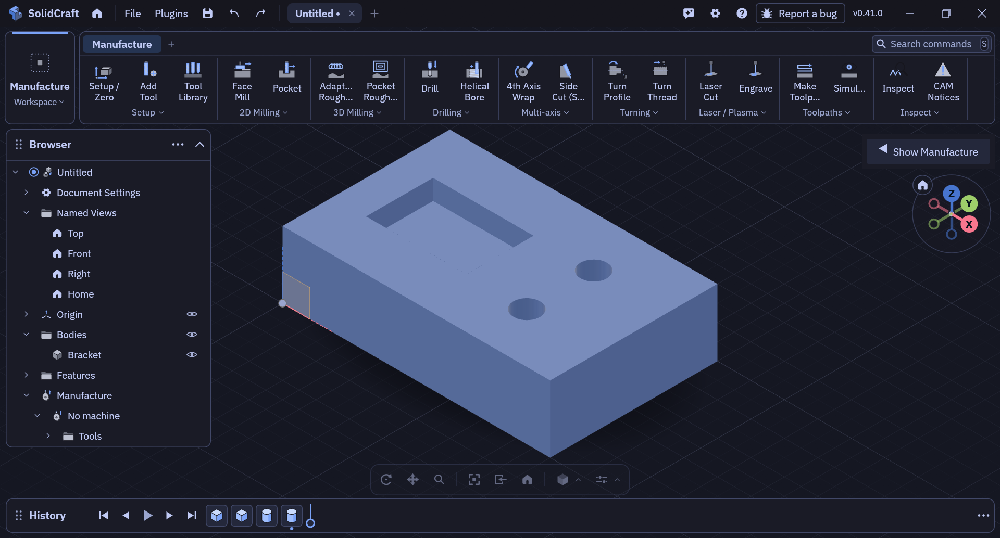

## 2. Setup / Zero, in two clicks [Setup]

1. **Click 1:** the face that points up on the machine. Already right? Press **Keep Z Up**.
2. **Click 2:** your zero, the point you touch off at the machine. Corners, edge middles, face centres and holes light up on the part and on the stock as you move the mouse.

The stock is a box around the part with the same margin on every side (1 mm to start). Change that one number for a bigger blank. Round stock, a fixed size or the machine are under **Advanced**.

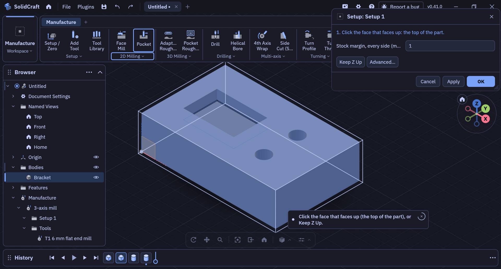

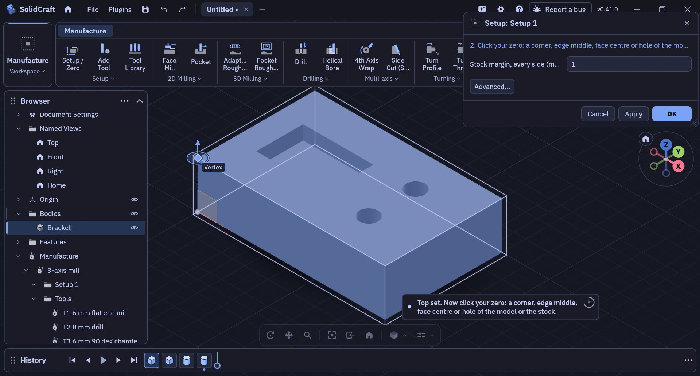

## 3. Get your tools

- **Tool Library** (Setup group): tick the tools you want, then **Add To This Design**.
- Or skip it: in any operation, set **Tool from** to a library and pick a tool. It is copied into this job for you.

Library tools are starting points. Set the diameter and shape to match your cutter. Lengths and offsets are set at the machine. Speeds and feeds are plain defaults: set your own.

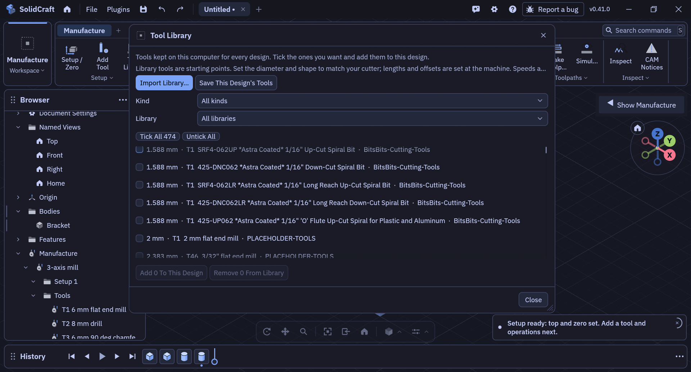

## 4. Add operations: click what you see

Hover the part first. The buttons that fit what the mouse is on light up on the ribbon; if the fitting one is inside a dropdown, the dropdown's name lights up.

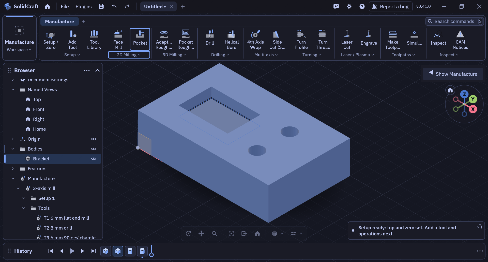

Click an operation button. One line tells you what to click:

| Operation | Click |
|---|---|
| Pocket [2D Pocket] | the floor of the pocket (or a wall, or the edge along its top) |
| Profile [2D Contour] | an outside wall or its top edge |
| Face Mill [Face] | the top, or press Whole Stock Top |
| Drill | each hole (its wall or rim), then Done |
| Helical Bore / Circle Mill | each hole, then Done |
| Chamfer [2D Chamfer] | near the edge to chamfer; only that edge's loop is cut |
| Adaptive / Pocket Roughing, Raster / Waterline Finish | the faces, then Done, or Whole Part |
| Side Cut [Swarf] | the wall |
| Flow / Morph | two edges |
| 4th Axis Wrap, Turning | pick the tool, press Go |
| Engrave, Trace, Laser, Plasma | the sketch shape |

While you hover, a small box shows the settings that belong to what is under the mouse, and you can change them right there.

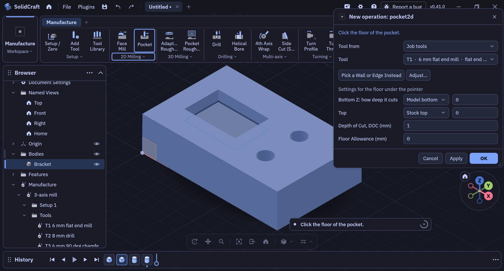

One click, and the operation is added **and** its toolpath is made.

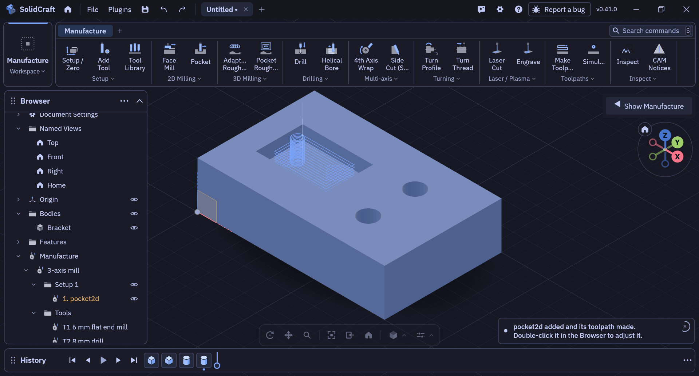

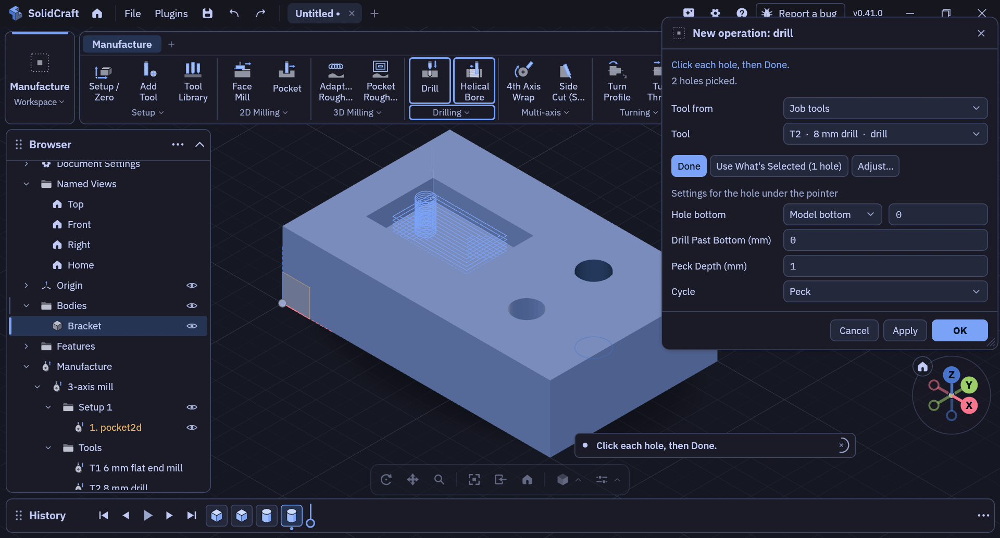

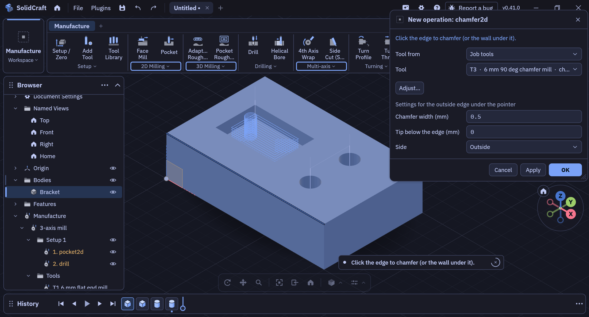

**Starting numbers** (change them for your machine and material): Depth of Cut 1 mm, Stepover 1 mm, Peck Depth 1 mm (pecking, G83), Chamfer width 0.5 mm.

Need the full form (leads and ramps, Safe Z, passes, tabs, tolerance)? Press **Adjust**, or double-click the operation in the Browser later. Picked the wrong thing? Open the operation and press **Pick on the Model**.

## 5. Check it: Simulate

- Click **Simulate**. Anything not made yet is made first.
- Use **1×** or **Move ›** to watch drilling pecks one by one.
- **Red** in the simulation means cutting into the part as drawn (a chamfer you didn't draw on the model shows red; draw it and the red goes).
- **Yellow** operation = a warning, not an error (most often: the setup's machine has no limits set). **Red** operation = it couldn't be made; open it to see why.
- Close the simulation to see your model again. The CAM never changes the model.

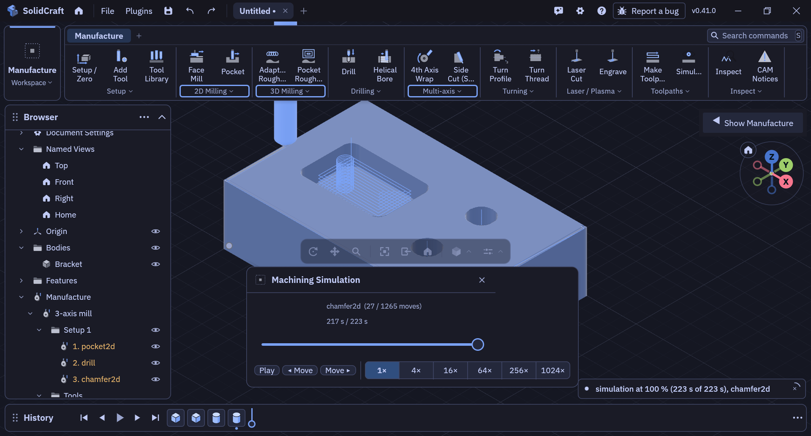

## 6. Make the G-code [Post Process]

Click **Make G-code**, pick your post processor (**Mach3** for .tap files) and save. The Mach3 post does manual tool changes, peck drilling and the A axis for rotary.

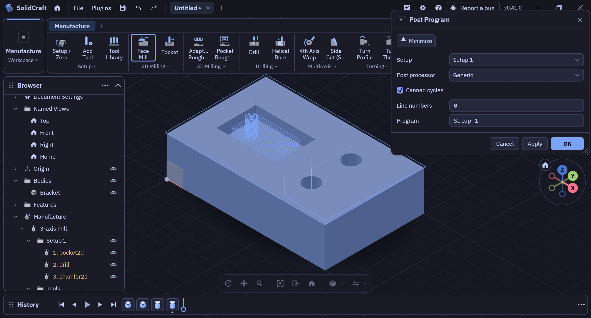

## 7. At the machine

- Touch off the zero you clicked in step 2. Set tool lengths at the machine.
- Air-cut it first. The simulation is a check, not a promise.
- Tune feeds and speeds by sound. No preset can hear your machine.

---

SolidCraft is by tangency-labs. The CAM branch is jb69's; the plasma cut order and the tool-list format come from HansFel's SolidCraftCam. The full list of this fork's changes is in the release notes at the end of the PDF.
